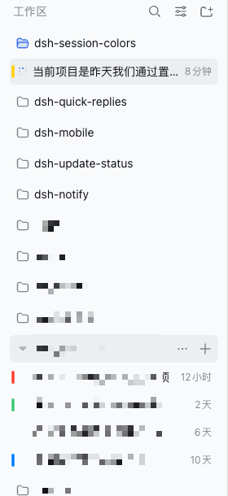
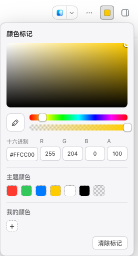
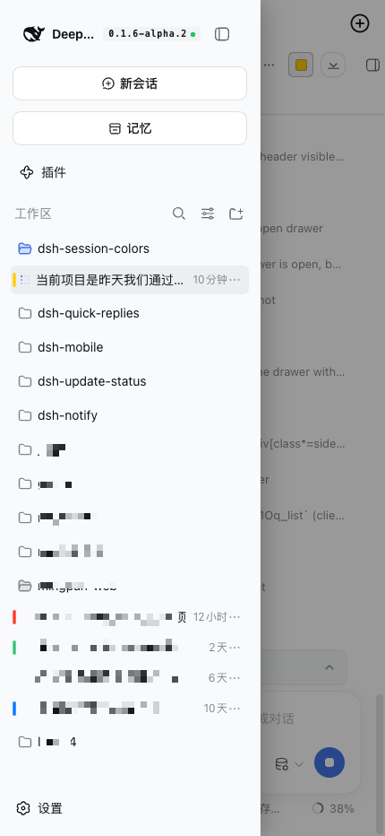

<h1 align="center">DSH Session Colors</h1>

<p align="center">Give any Session a colour and spot it at a glance in the sidebar.</p>

<p align="center">
  <a href="https://www.npmjs.com/package/@idoall/dsh-session-colors"></a>
  <a href="LICENSE"></a>
</p>

<p align="center">English | <a href="README.zh.md">中文</a></p>

<p align="center">
  <a href="#features">Features</a> ·
  <a href="#install">Install</a> ·
  <a href="#usage">Usage</a> ·
  <a href="#compatibility">Compatibility</a> ·
  <a href="#cross-device-and-lan">Cross-device</a> ·
  <a href="#configuration">Configuration</a> ·
  <a href="#troubleshooting">Troubleshooting</a> ·
  <a href="#security-boundaries">Security</a> ·
  <a href="#limitations">Limitations</a> ·
  <a href="#uninstall">Uninstall</a> ·
  <a href="#development">Development</a>
</p>

> **✅ Supports DSH `0.2.3-alpha.2` — the newest alpha (npm `alpha`).** Compatibility checked against the installed runtime, as well as the previously verified `0.2.2-rc.5`, `0.2.2-rc.4`, `0.2.2-rc.3`, `0.2.2-rc.1`, `0.2.2-alpha.3`, `0.2.2-alpha.2`, `0.2.1-rc.4`, `0.2.1-rc.3`, `0.2.1-rc.2`, `0.2.1-alpha.5`, `0.2.1-alpha.4`, `0.2.1-alpha.3`, `0.2.0-rc.2`, `0.2.0-rc.1`, `0.1.7-rc.2`, `0.1.7-rc.1` and `0.1.7-alpha.2`; see [Compatibility](#compatibility).

> DSH Session Colors is a DeepSeek Harness community plugin. It does not modify
> DSH core and does not rewrite any Session or Workspace data: a mark is only
> "Session id → one colour".

Work is spread across several workspaces, and the workspace list is a wall of
look-alike titles. Once a task finishes, the Session you were just in is hard to
find again — the status dot is idle and the title is one of twenty. **A colour you
chose yourself is the cheapest way to make one row recognisable.**

<p align="center">
  
</p>

## Features

- **A colour mark on the Session row** — a short bar in the row's left padding
  that **deliberately avoids the status dot**, so "which one finished" is never
  covered up.
- **A system-style colour picker** — a large saturation/value field, hue and alpha
  sliders, hex and RGBA fields, seven theme swatches, your saved colours, and
  screen eyedropper where the browser supports `EyeDropper`. It sits in the
  Session header's utilities, not next to the title.
- **Marked once, visible everywhere.** Marks live on the **Host**, not in the
  browser, so a colour chosen on your computer is also there on your phone —
  over a LAN address or a tunnel alike.
- **Visible on a phone too.** A phone turns the sidebar into a drawer, and the
  chips follow it: they travel with the drawer as it slides in, and they are
  painted above it.
- **Changes arrive on their own.** The page re-reads marks when it becomes
  visible again and every 20 seconds, so a colour set on another device shows up
  without a refresh.
- **Never blocks the UI.** The chip layer is click-through and clipped to the
  sidebar's scroll container; the worst case is that a chip does not appear.
- **A failure says so.** When the store cannot be reached, the header control
  shows ⚠ with a reason instead of looking like a Session with no colour.

<p align="center">
  
</p>

## Install

Requirements:

- DeepSeek Harness with a Web profile
- Node.js 20 or newer up to DSH `0.2.2`; DSH `0.2.3-alpha.1` and later require Node.js `24.22.3+` (24.x line) or `26.13.1+`
- **Verified DSH version: `0.2.3-alpha.2`** (the newest alpha),
  `0.2.2-rc.5`, `0.2.2-rc.4`, `0.2.2-rc.3`, `0.2.2-rc.1`, `0.2.2-alpha.3`, `0.2.2-alpha.2`, `0.2.1-rc.4`, `0.2.1-rc.3`, `0.2.1-rc.2`, `0.2.1-alpha.5`, `0.2.1-alpha.4`, `0.2.1-alpha.3`, `0.2.0-rc.2`, `0.2.0-rc.1`,
  `0.1.7-rc.2`, `0.1.7-rc.1` and `0.1.7-alpha.2` — plugin `0.1.20`
  (see [Compatibility](#compatibility))

```sh
dsh plugin --profile <profile> add @idoall/dsh-session-colors@latest
```

The [compatibility table](#compatibility) lists the exact versions, if you need to
pin one to a specific DSH release.

Working on the plugin itself? Install the directory instead:

```sh
dsh plugin --profile <profile> add link:/path/to/dsh-session-colors
```

Then give it a data directory in the profile's `cordis.patch.yml` — the same
shape other plugins that need durability use, because **the plugin never guesses
the profile path**:

```yaml
- id: dsh-session-colors
  config:
    dataDir: /absolute/path/to/profiles/<profile>/data/dsh-session-colors
```

Finally **restart `dsh web`** (the Host half loads only at boot), then refresh the
Web GUI. It also works without `dataDir`, but then marks live only for the life of
the Host process.

## Usage

1. Open the Session you want to mark.
2. Click the colour control in the Session header (🎨 when the Session has no
   colour, the colour itself once it has one).
3. Pick a colour, or paste a hex value. The bar appears on that Session's sidebar
   row immediately.
4. To clear it, open the picker again and click **Clear mark**, or choose the
   transparent swatch among the theme colours.

Opening the picker on a marked Session starts from its current colour. Colours are
stored as HSVA, so alpha round-trips exactly.

<p align="center">
  
</p>

## Compatibility

Current release: plugin **`0.1.20`** is compatibility-checked against DeepSeek Harness
**`0.2.3-alpha.2`** — the newest alpha (npm `alpha`) — and retains
previous verification for **`0.2.2-rc.5`**, **`0.2.2-rc.4`**, **`0.2.2-rc.3`**, **`0.2.2-rc.1`**, **`0.2.2-alpha.3`**, **`0.2.2-alpha.2`**, **`0.2.1-rc.4`**, **`0.2.1-rc.3`**, **`0.2.1-rc.2`**, **`0.2.1-alpha.5`**, **`0.2.1-alpha.4`**, **`0.2.1-alpha.3`**, **`0.2.0-rc.2`**,
**`0.2.0-rc.1`**, **`0.1.7-rc.2`**, **`0.1.7-rc.1`** and **`0.1.7-alpha.2`**.

| Plugin version | Verified DeepSeek Harness | npm status | What it is |
| --- | --- | --- | --- |
| **`0.1.20`** | **`0.2.3-alpha.2`** (alpha), `0.2.2-rc.5` (RC), `0.2.2-rc.4`, `0.2.2-rc.3`, `0.2.2-rc.1`, `0.2.2-alpha.3`, `0.2.2-alpha.2`, `0.2.1-rc.4`, `0.2.1-rc.3`, `0.2.1-rc.2`, `0.2.1-alpha.5`, `0.2.1-alpha.4`, `0.2.1-alpha.3`, `0.2.0-rc.2`, `0.2.0-rc.1`, `0.1.7-rc.2`, `0.1.7-rc.1`, `0.1.7-alpha.2` | `latest` | Fixes Host-route authentication for DSH `0.2.3`, where `connection.requestRejection` was replaced by the route declaration's `auth` field, and records `0.2.3-alpha.2` compatibility. No storage-format change; no migration from `0.1.19`. |
| **`0.1.19`** | **`0.2.2-rc.5`** (RC), `0.2.2-rc.4`, `0.2.2-rc.3`, `0.2.2-rc.1`, `0.2.2-alpha.3`, `0.2.2-alpha.2`, `0.2.1-rc.4`, `0.2.1-rc.3`, `0.2.1-rc.2`, `0.2.1-alpha.5`, `0.2.1-alpha.4`, `0.2.1-alpha.3`, `0.2.0-rc.2`, `0.2.0-rc.1`, `0.1.7-rc.2`, `0.1.7-rc.1`, `0.1.7-alpha.2` | `published` | Records DSH `0.2.2-rc.5` compatibility. Executable code and load range unchanged; no migration from `0.1.18`. |
| `0.1.18` | `0.2.2-rc.4` (RC), `0.2.2-rc.3`, `0.2.2-rc.1`, `0.2.2-alpha.3`, `0.2.2-alpha.2`, `0.2.1-rc.4`, `0.2.1-rc.3`, `0.2.1-rc.2`, `0.2.1-alpha.5`, `0.2.1-alpha.4`, `0.2.1-alpha.3`, `0.2.0-rc.2`, `0.2.0-rc.1`, `0.1.7-rc.2`, `0.1.7-rc.1`, `0.1.7-alpha.2` | `published` | Records DSH `0.2.2-rc.4` compatibility. Executable code and load range unchanged; no migration from `0.1.17`. |
| `0.1.17` | `0.2.2-rc.3` (RC), `0.2.2-rc.1`, `0.2.2-alpha.3`, `0.2.2-alpha.2`, `0.2.1-rc.4`, `0.2.1-rc.3`, `0.2.1-rc.2`, `0.2.1-alpha.5`, `0.2.1-alpha.4`, `0.2.1-alpha.3`, `0.2.0-rc.2`, `0.2.0-rc.1`, `0.1.7-rc.2`, `0.1.7-rc.1`, `0.1.7-alpha.2` | published | Declares the picker panel's own macOS Desktop window region (`data-window-drag-exclude`), which DSH `0.2.2-rc.1` made necessary for a custom overlay inside a drag row. Host, storage format and load range unchanged; no migration from `0.1.16`. |
| `0.1.16` | `0.2.2-rc.1` (RC), `0.2.2-alpha.3`, `0.2.2-alpha.2`, `0.2.1-rc.4`, `0.2.1-rc.3`, `0.2.1-rc.2`, `0.2.1-alpha.5`, `0.2.1-alpha.4`, `0.2.1-alpha.3`, `0.2.0-rc.2`, `0.2.0-rc.1`, `0.1.7-rc.2`, `0.1.7-rc.1`, `0.1.7-alpha.2` | published | Records DSH `0.2.2-rc.1` compatibility. Executable code and load range unchanged; no migration from `0.1.15`. |
| `0.1.15` | `0.2.2-alpha.3` (alpha), `0.2.2-alpha.2`, `0.2.1-rc.4`, `0.2.1-rc.3`, `0.2.1-rc.2`, `0.2.1-alpha.5`, `0.2.1-alpha.4`, `0.2.1-alpha.3`, `0.2.0-rc.2`, `0.2.0-rc.1`, `0.1.7-rc.2`, `0.1.7-rc.1`, `0.1.7-alpha.2` | published | Fixes chip tracking for the alpha.3 native drawer with reduced motion or instant close. Host and load range unchanged; no migration from `0.1.14`. |
| `0.1.14` | `0.2.2-alpha.2` (alpha), `0.2.1-rc.4`, `0.2.1-rc.3`, `0.2.1-rc.2`, `0.2.1-alpha.5`, `0.2.1-alpha.4`, `0.2.1-alpha.3`, `0.2.0-rc.2`, `0.2.0-rc.1`, `0.1.7-rc.2`, `0.1.7-rc.1`, `0.1.7-alpha.2` | published | Records DSH `0.2.2-alpha.2` compatibility and adds the `0.2.2` prerelease tuple to the declared load range. No executable-code change; upgrading from `0.1.13` needs no migration. |
| `0.1.13` | `0.2.1-rc.4` (RC), `0.2.1-rc.3`, `0.2.1-rc.2`, `0.2.1-alpha.5`, `0.2.1-alpha.4`, `0.2.1-alpha.3`, `0.2.0-rc.2`, `0.2.0-rc.1`, `0.1.7-rc.2`, `0.1.7-rc.1`, `0.1.7-alpha.2` | published | Records DSH `0.2.1-rc.4` compatibility. No executable-code or load-range change; upgrading from `0.1.12` needs no migration. |
| `0.1.12` | `0.2.1-rc.3` (RC), `0.2.1-rc.2`, `0.2.1-alpha.5`, `0.2.1-alpha.4`, `0.2.1-alpha.3`, `0.2.0-rc.2`, `0.2.0-rc.1`, `0.1.7-rc.2`, `0.1.7-rc.1`, `0.1.7-alpha.2` | published | Records DSH `0.2.1-rc.3` compatibility. No executable-code or load-range change; upgrading from `0.1.11` needs no migration. |
| `0.1.11` | `0.2.1-rc.2` (RC), `0.2.1-alpha.5`, `0.2.1-alpha.4`, `0.2.1-alpha.3`, `0.2.0-rc.2`, `0.2.0-rc.1`, `0.1.7-rc.2`, `0.1.7-rc.1`, `0.1.7-alpha.2` | published | Verifies the same code on DSH `0.2.1-rc.2`, where every package this plugin consumes is byte-identical to `0.2.1-alpha.5`. No logic change over `0.1.10`; upgrading needs no migration. |
| `0.1.10` | `0.2.1-alpha.5` (alpha), `0.2.1-alpha.4`, `0.2.1-alpha.3`, `0.2.0-rc.2`, `0.2.0-rc.1`, `0.1.7-rc.2`, `0.1.7-rc.1`, `0.1.7-alpha.2` | published | Verifies the same code on DSH `0.2.1-alpha.5`, where every package this plugin consumes is byte-identical to `0.2.1-alpha.4`. No logic change over `0.1.9`; upgrading needs no migration. |
| `0.1.9` | `0.2.1-alpha.4` (alpha), `0.2.1-alpha.3`, `0.2.0-rc.2`, `0.2.0-rc.1`, `0.1.7-rc.2`, `0.1.7-rc.1`, `0.1.7-alpha.2` | published | Verifies the same code on DSH `0.2.1-alpha.4` and moves the load range to the field that alpha.4 actually enforces, top-level `engines.dsh`. No logic change over `0.1.8`; upgrading needs no migration. |
| `0.1.8` | `0.2.1-alpha.3` (alpha), `0.2.0-rc.2`, `0.2.0-rc.1`, `0.1.7-rc.2`, `0.1.7-rc.1`, `0.1.7-alpha.2` | published | Verifies the same code on DSH `0.2.1-alpha.3` and names that tuple in the declared load range. No logic change over `0.1.7`; upgrading needs no migration. |
| `0.1.7` | `0.2.0-rc.2` (RC), `0.2.0-rc.1`, `0.1.7-rc.2`, `0.1.7-rc.1`, `0.1.7-alpha.2` | published | Verifies the same code on DSH `0.2.0-rc.2` and adds that exact version to the declared load range. No logic change over `0.1.6`; upgrading needs no migration. |
| `0.1.6` | `0.2.0-rc.1` (RC), `0.1.7-rc.2`, `0.1.7-rc.1`, `0.1.7-alpha.2` | published | Verifies the same code on DSH `0.2.0-rc.1` and rewrites the declared load range so the plugin survives the `0.2.0` final release. No code change over `0.1.5`; upgrading needs no migration. |
| `0.1.5` | `0.1.7-rc.2` (latest 0.1.7 RC), `0.1.7-rc.1`, `0.1.7-alpha.2` | published | Confirms the same code runs unchanged on the second release candidate and declares it. No code change over `0.1.4`; upgrading needs no migration. |
| `0.1.4` | `0.1.7-rc.1` (RC), `0.1.7-alpha.2` | published | Confirms the `0.1.7` adaptation runs unchanged on the first release candidate and declares it. No code change over `0.1.3`. |
| `0.1.3` | `0.1.7-alpha.2` | published | Adapts to DSH 0.1.7: the Session id comes from the row's own `data-row-key` (fiber fallback kept), chips follow the Web-Animations row gliding `0.1.7` introduced, and the Host dependency is declared the way `0.1.7` resolves a linked plugin. |
| `0.1.2` | `0.1.6-alpha.2` | published | Fixes chips staying at their old coordinates for ~20s when a workspace is collapsed or expanded: a second `MutationObserver.observe()` on the same target had silently replaced the `childList` watch. |
| `0.1.1` | `0.1.6-alpha.2` | published | Documentation only: the packaged README no longer says "not published", and the market screenshots are declared. |
| `0.1.0` | `0.1.6-alpha.2` | published | First release: Session colour marks, Host-side storage, visible inside a phone's sidebar drawer |

**`0.1.20` supports DSH `0.2.3-alpha.2`, the newest alpha (npm `alpha`), and fixes a real break there.** DSH `0.2.3` moved route authentication into the route declaration: `webServer.register` now takes `auth` (`anonymous` | `required` | `deny`, defaulting to `required`), the platform applies the Host/Origin fence and the registered authentication before the handler runs, and it hands the admitted Peer to the handler as the third argument. The `connection.requestRejection(request)` method that earlier releases exposed **was removed**. The previous Host half called it unconditionally, so on `0.2.3` the call threw, the "a fence that cannot answer must not become an open door" catch answered `403`, and every *authenticated* request — the only ones that reach the handler — was refused: the sidebar chips stopped appearing and the picker could not load or save a colour, while the plugin still looked installed and healthy. Unauthenticated probes still returned `401` from the platform, which is why the route looked alive. The fix declares `auth: 'required'` on both routes, keeps calling the per-request fence only on a release that still has it, and otherwise refuses any request that arrives without a Peer. Both shapes are covered by tests, so the same build serves `0.1.7-alpha.2` through `0.2.3-alpha.2`.

Also from this DSH line: **Node.js `24.22.3+` (24.x) or `26.13.1+` is required** from `0.2.3-alpha.1`, because that is the first release whose bundled `undici` carries the November 2026 security fixes. Older DSH releases still run on Node 20, so the package's own `engines.node` stays `>=20` and the requirement above is documented rather than enforced here.

Everything on the browser side is unchanged: the `conversation.session.header.utilities` and `shell.overlay` slots are still declared, Session rows still carry `data-row-key="session:<id>"`, `role="treeitem"` and `aria-selected` in `dsh-client-ui-workspace`, the list still scrolls inside a `.listArea` ancestor, the hand-authored `__ModuleLoader__.load({id, factory})` bundle contract and the locale `register`/`bind` API are untouched, `react-dom` is still a shell static module, and the macOS window-drag CSS still carries `[data-window-drag-exclude]`, so the `0.1.17` panel declaration keeps working. Host-side, `webServer.register` keeps returning a disposer and the exact-route shape is the same apart from the new `auth` field.

All 43 unit tests pass, including three new ones for the two authentication shapes: platform-fenced (200 with a Peer, 401 without one) and connection-fenced (403 when the fence refuses or throws, 200 when it admits). This release **does not claim real GUI, mobile or cross-device visual acceptance**, and the fix was not exercised against a live `0.2.3` profile because that needs an install and a restart. No temporary server was started, no other plugin was touched, and the local profile was not modified.

Registry check on 2026-11-23: DSH `alpha` is `0.2.3-alpha.2`, while `latest` and `next` remain `0.2.2-rc.5`.

`0.1.9` moved that range to top-level `engines.dsh`, the field DSH `0.2.1-alpha.4`
made authoritative — it decides alone when present, and the marketplace reads the
same field. That relocation still stands and is unchanged here.
**Upgrading from `0.1.19` needs no migration.** On an older DSH — including
`0.1.6-alpha.2` — keep plugin **`0.1.2`**. Newer DSH releases are not
auto-declared compatible.

- **Verified DeepSeek Harness** lists the exact DSH releases assessed for this
  plugin. Verification depth and any browser-testing limits are stated above. That list has one home — `dsh.compatibility.dshReleases` in
  [`package.json`](package.json) — and a test keeps both READMEs' compatibility
  sections word-for-word with it and inside the range both `peerDependencies` and
  `engines.dsh` declare. A DSH version that is not listed is **never claimed as
  compatible**.
- `peerDependencies` declare `>=0.1.7-alpha.2 <0.2.0-0 || 0.2.0-rc.1 || 0.2.0-rc.2 || >=0.2.0 <0.3.0 || >=0.2.1-alpha.3 <0.3.0 || >=0.2.2-alpha.2 <0.3.0 || >=0.2.3-alpha.2 <0.3.0`
  for `dsh-client-ui-layout` and `dsh-client-ui-conversation`, and top-level
  `engines.dsh` declares the same range as the Host requirement: that is the
  range allowed to **load**, which is not the same as verified. DSH evaluates it
  with `semver.satisfies(runtime, range, { includePrerelease: true })`, so
  prereleases *do* participate: the `0.2.2` alternative alone already admits any
  later `0.2.2` or `0.2.3` prerelease, not just the ones named here. The seven
  alternatives still buy precision: `0.2.0-rc.1` and `0.2.0-rc.2` are pinned
  exactly, because a comparator written for the stable `0.2.0` line would also
  admit an unassessed `0.2.0-rc.3`, while the stable `0.2.0` comparator admits the
  final release; and each `0.2.x` alternative names the alpha this repository
  actually assessed. That matters because the *stricter* check in
  `tests/docs.test.mjs` applies node-semver's default rule, where a prerelease is
  admissible only when a comparator names its exact `major.minor.patch`, and
  every verified release must satisfy it. So the load range is deliberately wider
  than the verified list under the runtime's own rule, while nothing untested is
  ever *claimed* compatible. The lower bound names the alpha on
  purpose: a range like `>=0.1.6-0 <0.2.0` admits none of the verified versions.
- DSH evaluates those requirements at boot and **disables** a plugin row whose
  range is not satisfied, so a correct range is load-bearing rather than
  cosmetic. Since `0.2.1-alpha.4`, the boot precheck gives top-level
  `engines.dsh` priority over peer ranges (which is why `0.1.9` moved the range
  there). The declared DSH range accepts `0.2.3-alpha.2`, which is why this release adds the `0.2.3` comparator.
- DSH 0.1.7-rc.2 added a real Session-row seat,
  `sidebar.session.row.leading` — a 16px cell before the title. The chip
  deliberately **stays on its own click-through layer**: that seat shares its cell
  with the status dot and is mounted **only while the row is idle** (a running,
  waiting or archived row renders no occupant), so a chip placed there would
  vanish exactly when it is most useful. See
  [Limitations](#limitations) and the design record.
- `@deepseek-ai/schemastery` is a **peer**, not a plain dependency: DSH 0.1.7
  resolves only a linked plugin's peer dependencies from the running
  installation, so a `link:` install of this directory would otherwise fail to
  import the Host half.
- DSH moving faster than this plugin does not break it: chips depend on DSH's row
  DOM (see [Limitations](#limitations)), so a large change to the row structure
  can at worst stop chips from appearing — it cannot block clicking.

## Cross-device and LAN

Storage goes through the plugin's **own** HTTP route
(`GET`/`POST /plugins/dsh-session-colors/marks`), persisted to one JSON file in
the profile's data directory. That is deliberate:

DSH's own user-settings service host-backs settings **only for loopback pages** —

```js
persistence = $host.isLoopback ? "host" : "memory"
```

— so a page opened over a LAN address or a tunnel gets a permanently unavailable
scope: it can neither read nor write. An own route is not subject to that rule,
which is exactly what makes a mark visible on every device. LAN forwarders
(`dsh-bridge`, `dsh-lan-proxy`, and friends) rewrite `Host`/`Origin` to loopback
and inject the auth cookie, so a request that arrives over the LAN still looks
like loopback to DSH and the route answers normally.

## Configuration

| Field | Type | Meaning |
| --- | --- | --- |
| `dataDir` | absolute path | Where `session-colors.json` is written. Without it, marks live in process memory only. |

A mark is one JSON document:

```json
{
  "version": 1,
  "marks": {
    "session-0698599a-…": { "h": 211.3, "s": 1, "v": 1, "a": 1 }
  }
}
```

Writes are **atomic** (temporary file, then rename). To drop a mark, use **Clear
mark** in the picker, or remove that line from the file.

## Troubleshooting

**The colour still is not visible on my phone.**
First check which build the device runs:

```text
[dsh-session-colors] build=host-routes+row-strips marks route status=...
```

If `build` is not `host-routes+row-strips`, the device is running a
**cached client**: refresh the page (the browser half reloads on a refresh, no DSH
restart needed). If `status` is not `ready`, the store cannot be read — see
the next item.

**The header control shows ⚠.**
That means the store cannot be reached: `dshScError` carries the reason and
`dshScWritable` says whether writes are possible. This happens when the Host route
was never registered (the profile did not load the plugin) or the data directory
is not writable. It is **not** the same as "this Session has no colour".

**A LAN page behaves differently.**
Since `0.1.0` this plugin behaves identically on LAN/tunnel pages and loopback
pages, because storage uses its own route. If you see the old "settings
unavailable" behaviour, check which version is installed.

**Chips are in the wrong place, or gone.**
The layer finds rows by ARIA role and reads the Session id from the row's
`data-row-key` (falling back to React internals). A large change to DSH's sidebar
structure can make it find nothing; chips then disappear, but **clicking is
unaffected** because the layer is click-through.

## Security boundaries

- A mark stores **only a Session id and a colour**. It never writes Session logs,
  titles, history, status, archive records, or Workspace membership.
- It **never creates, copies, moves, or reorders a Session**; a mark is not part
  of Session data.
- The chip layer **never accepts pointer events** and is clipped to the sidebar's
  scroll container: the worst case is a chip that does not appear.
- The Host route reuses DSH's own auth fence (`connection.requestRejection`), and
  writes add a same-origin check on top.
- The plugin registers no model Tool, spawns no subprocess, and only uses same-origin
  HTTP requests for marks; it contacts no third-party service.

## Limitations

- **The strip depends on a row attribute.** Each rule matches the row's own
  `data-row-key` (`session:<id>`): there is no overlay and no per-row measuring,
  so the strip moves with the list in the same frame. A future DSH release that
  drops the attribute stops the strips from appearing; it cannot break clicking.
  Search-result rows do not carry it, so they show no strip.
- **The strip is painted by the row.** DSH gives each row a 3px transparent
  inline border; `padding-box` clipping leaves the strip about 3px wide against
  the row's left edge, clear of the status dot.
- **Marks are per DSH instance.** They live in one profile's data directory, so
  two independent DSH servers do not share them.
- **No permission model.** Anyone who can reach the Host's authenticated routes
  for this profile can read and write marks.
- **Colour only.** No labels, icons, or emoji.

## Uninstall

```sh
dsh plugin --profile <profile> remove @idoall/dsh-session-colors
```

Restart DSH and refresh the Web GUI. `session-colors.json` in the data directory
is not deleted for you; remove it yourself if you do not want it.

## Development

```sh
npm test        # 39 tests: bundle shape, store, route, cross-device, geometry, docs
```

The browser half is a hand-authored `__ModuleLoader__` bundle, which is the only
format the DSH client loader accepts for a package client half. It is written by
hand on purpose: there is no build step, so nothing can drift from the DSH
version it targets.

```
src/index.js       Host half: routes, the JSON store, auth fence
src/client.js      Browser half: picker, chip layer, the fetch-backed store
tests/             Unit tests for both halves, plus the doc-consistency checks
docs/              The design record (Chinese) and the README screenshots
demos/             A standalone HTML demo of the picker
```

Design decisions and measurements live in
[docs/plugin-design.zh.md](docs/plugin-design.zh.md) (the current part starts at
the 「会话颜色标记版」 section).

## License

[MIT](LICENSE)
